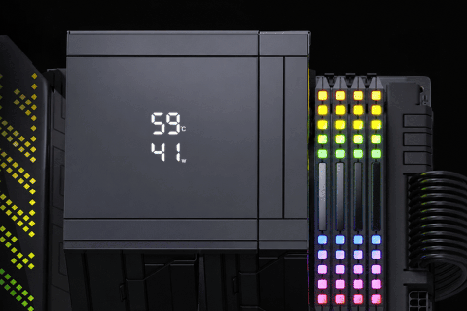

# CoolerDisplay



Replacement for the vendor "CPU TEMP Monitor" app that drives the two-row 7-segment
display on the CPU cooler. The vendor app reads sensors through LibreHardwareMonitor 0.9.4 and its
**WinRing0** driver, which Microsoft Defender flags as `VulnerableDriver:WinNT/Winring0`.
CoolerDisplay uses LibreHardwareMonitor 0.9.6, which reaches the hardware through the signed, sandboxed
**PawnIO** driver instead.

| Part | How it is accessed | Driver needed |
|---|---|---|
| Display | Standard Windows HID feature report | none |
| CPU load | LibreHardwareMonitor (Windows counters) | none |
| CPU temperature (Tctl/Tdie), package power | LibreHardwareMonitor → PawnIO | PawnIO, elevated process |

## Hardware

- **Cooler:** Snowman (冰曼) MT880, digital-display version.
- **Display controller:** USB HID `1A2C:4984`, the same controller other Snowman display coolers and the
  Rise Mode Temp 6 use.

## Display protocol

The cooler enumerates as a USB "keyboard", `VID_1A2C&PID_4984`. The display is the vendor-defined
collection (usage page `0xFF01`, interface `MI_01`, collection `COL07`) with a 64-byte feature report:

| Byte | Meaning |
|---|---|
| 0 | Report ID `0x07` |
| 1–3 | Top row digits (hundreds, tens, ones) as raw values 0–9 |
| 4 | Flags: bit 0 = top row °F (else °C), bit 4 = bottom row load % (else W) |
| 5–7 | Bottom row digits |
| 8–63 | Zero |

The protocol was first documented by the Linux drivers
[Anatdx/cputmpmonitor](https://github.com/Anatdx/cputmpmonitor) and
[matheus-paula/risemode-temp6-driver](https://github.com/matheus-paula/risemode-temp6-driver).

## Install

Download `CoolerDisplay-<version>-win-x64.zip` from
[Releases](https://github.com/n0uur/cpu-cooler-display/releases). It is self-contained, so .NET does
not need to be installed. Extract it, then in an elevated PowerShell inside the extracted folder:

```powershell
.\install.ps1 [-Fahrenheit] [-Load] [-RemoveVendor]
```

To build from source instead (.NET 8 SDK), run `dotnet publish -c Release -o publish` in the repo, then
run `install.ps1` the same way.

`install.ps1`:

1. Installs PawnIO with `winget install namazso.PawnIO` if LibreHardwareMonitor does not detect it.
2. Copies `publish\` to `C:\Program Files\CoolerDisplay`. An elevated task must not run from a
   user-writable folder.
3. Checks that a real CPU temperature can be read, and stops if it cannot.
4. Disables the vendor's `CPU TEMP Monitor StartupTask`, because two writers would fight over the
   display. `-RemoveVendor` also deletes that task, runs the vendor uninstaller, and removes any leftover
   WinRing0 service.
5. Registers the `CoolerDisplay` scheduled task. It runs as SYSTEM at startup, so it works before logon,
   and restarts every minute if it fails.

Settings are baked into the task's arguments: re-run `install.ps1` with different switches to change them.

Remove CoolerDisplay with `.\uninstall.ps1` (elevated). It leaves PawnIO installed because other tools
(LibreHardwareMonitor, Fan Control, …) share it. Remove PawnIO separately with
`winget uninstall namazso.PawnIO` if nothing else needs it.

## Commands

```text
CoolerDisplay [run]            push temperature + power/load every --interval ms (default 1000)
CoolerDisplay once             print one reading and send one frame
CoolerDisplay sensors          list all CPU sensors and PawnIO status
CoolerDisplay devices          list the cooler's HID collections (* = display)
CoolerDisplay test TOP BOTTOM  show fixed numbers for --seconds (no admin, no PawnIO)

-f/--fahrenheit  -l/--load  --interval MS  --seconds N  --log PATH
```

The task logs state changes only (start, display connect/disconnect, temperature lost/regained) to
`C:\ProgramData\CoolerDisplay\cooler.log`. The log is rotated to `cooler.log.1` at 1 MB.

## Behaviour notes

- **Which temperature is shown.** The top row shows `Core (Tctl/Tdie)`, the same sensor the vendor app
  used. On Zen 4/5 it runs several degrees above the per-CCD `Tdie` readings at light load.
- **Missing temperature.** If the temperature becomes unreadable (PawnIO removed, task not elevated),
  the top row shows `000` and the log records why.
- **Unplug and sleep.** If the display is unplugged, or the USB stack resets across sleep, the failed
  write is logged and the device is reopened automatically.
- **Single instance.** Only one `run` instance drives the display at a time (global mutex).
